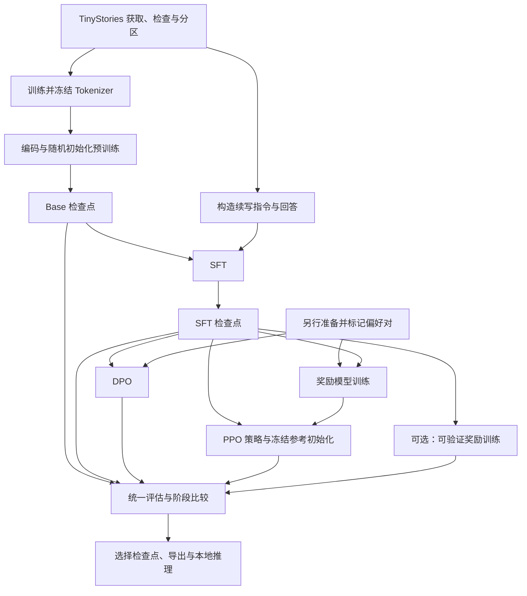

# TinyStories 语言模型训练项目：软件架构设计

设计日期：2026-10-28。

## 1. 项目目标与当前状态

在 i9-14900HX、RTX 4070 Laptop（8GB 专用显存）、32GB 内存的笔记本上，分阶段实现小型语言模型的完整训练流程。使用 TinyStories 英文短故事，自己训练 Tokenizer、随机初始化模型，并观察预训练与后训练带来的变化。

**本次只建立架构与文件骨架。所有 `.py` 文件只有用途注释；配置文件也只有注释。尚未下载数据、安装训练依赖、实现模型或执行训练。** 文档中出现的模块行为、数据格式、参数和产物均为后续实现约定。文件存在不代表相应功能已完成。

首轮优先完成“数据 → Tokenizer → 预训练 → SFT → DPO → 评估 → 导出”。为了完整学习经典 RLHF，另行实现奖励模型与 PPO；专项训练和可验证奖励保留独立实验入口。各阶段可以单独运行、检查结果和恢复，不需要一开始构建自动执行所有阶段的总流水线。

## 2. 设计原则

1. **单机单卡优先。** 首版不引入分布式训练、复杂插件注册或服务平台；先掌握损失、梯度和更新过程。
2. **入口薄、模块职责明确。** `scripts/` 解析参数并串联阶段；`llm/` 实现可复用逻辑。
3. **各阶段共享基础设施。** 数据约定、Tokenizer、模型骨干、配置、检查点和指标口径保持一致。
4. **监督训练与在线强化学习保留差异。** PPO 有生成轨迹与多轮更新，不强行塞进只支持固定标签的训练循环。
5. **每个实验可追溯。** 保存数据版本、分区、Tokenizer/模板指纹、配置、环境、随机种子和上游检查点。
6. **配置逐步明确。** 学习率、训练轮数等在相应阶段实现时通过小实验确定，不把未验证数值包装成最佳设置。

## 3. 模型与本地资源基线

采用便于逐层理解的 GPT 风格 Decoder-only Transformer。这里是本项目的设计选择，不要求逐项复现 TinyStories 论文模型。

| 项目 | 首轮设计 |
| --- | --- |
| Tokenizer | 从训练分区学习 byte-level BPE |
| 总词表 | 8192，包含所有特殊 Token；最终以保存的词表为准 |
| 层数 | 8 个 Transformer Block |
| 隐藏维度 | 384 |
| 注意力头 | 6，每头维度 64 |
| FFN | 中间维度 1536，GELU |
| 归一化与残差 | Pre-LN，各 Block 内注意力与 FFN 残差，末端 LayerNorm |
| 位置编码 | 可学习绝对位置 Embedding，最大上下文 512 |
| 输出头 | 与 Token Embedding 共享权重，不添加输出 bias |
| 参数初始化 | 从随机权重开始；不加载预训练语言模型 |
| 首轮预训练预算 | 50M 实际参与损失的目标 Token，属于试验预算 |

在词表恰为 8192、上下文 512、线性层带 bias、LayerNorm 带 scale/bias 且语言头共享权重的上述配置下，参数量设计估算为：

\[
N = Vd + Ld + n(12d^2+13d)+2d = 17{,}538{,}816.
\]

其中 `V` 为词表大小、`L` 为位置数、`n` 为层数。实现后必须重新统计实际参数量；奖励头、价值头及取消权重共享都会改变结果。50M Token 不代表该规模模型已经充分训练，后续依据开发集与吞吐量决定是否增加预算。

| 资源项 | 处理方式 |
| --- | --- |
| 显存预算 | 按 8GB 专用显存设计；16GB 共享 GPU 内存不作为额外高速显存 |
| 初始自检 | 2 层、128 隐藏维度、4 头、128 上下文和少量样本，单独的运行与检查点 |
| 精度 | 检测支持后使用 BF16 autocast；保留 FP32 参数与优化器状态；回退路径在实现时验证 |
| FP16 路径 | 若采用 FP16，则配套梯度缩放，裁剪前 unscale；溢出跳过更新时不推进调度器 |
| 预训练批量起点 | micro-batch 4、累积 16 次，先实测，再调整；不是显存保证 |
| 有效批量 | 单卡下为 micro-batch × 累积次数；满长时上述配置约 32768 输入位置/更新 |
| DPO | 从每批 1 对开始；可先缓存冻结参考模型 log-prob，训练时释放参考模型显存 |
| PPO | 从小量轨迹开始，例如 128 Token 提示预算＋128 Token 回答预算；单独测峰值 |
| 内存与磁盘 | 分片编码、分块或 mmap 读取；不一次性加载全语料或全部训练激活 |
| Windows | 首版数据加载以 0 worker 起步；未来入口使用 Windows 兼容的启动保护 |

先运行短时基准，记录实际 tokens/s、峰值显存和验证/保存开销，再估算训练时间；不预先承诺笔记本完成时间。资源不足时先降低微批量和序列长度，再评估激活检查点。各后训练阶段需分别测量，不沿用预训练的显存结论。

## 4. 阶段依赖与产物

DPO 与“奖励模型＋PPO”是从 SFT 检查点出发的两条偏好优化路线；DPO 不要求先训练奖励模型，PPO 也不要求先执行 DPO。首轮建议分别运行以便比较。专项训练可以复用继续预训练或 SFT；需要可验证奖励时使用 RLVR 入口。

| 阶段 | 输入 | 主要产物 |
| --- | --- | --- |
| 数据准备 | 固定版本 TinyStories | 带来源的故事、分区与 manifest |
| Tokenizer | 训练分区故事 | Tokenizer 文件、特殊 Token 表、指纹 |
| 编码 | 各分区故事＋冻结 Tokenizer | Token 分片、故事边界、统计 |
| 预训练 | 随机模型＋训练 Token | Base 检查点、开发指标、生成样例 |
| SFT | Base＋续写指令/回答 | SFT 检查点、回答损失与样例 |
| DPO | SFT＋偏好对＋冻结参考概率 | DPO 检查点、偏好指标 |
| 奖励模型 | SFT 骨干＋偏好对 | 标量奖励模型与独立验证指标 |
| PPO | SFT 策略/参考＋奖励模型＋提示 | 策略及价值状态、轨迹指标 |
| RLVR | 指定策略＋可检查任务/奖励规则 | 专项策略与约束通过率 |
| 评估与导出 | 选定检查点＋固定评估集合 | 对比报告、样例、推理制品 |

## 5. 实际目录结构

采用根目录 Python 包布局，避免首版为了 `src/` 布局额外引入安装配置。未来入口按从仓库根目录运行 Python 模块的方式设计；当前没有可用训练命令。

| 路径 | 职责与版本管理 |
| --- | --- |
| `README.md` | 项目入口与当前实现状态 |
| `ARCHITECTURE.md` | 本文：整体架构与实现路线 |
| `.gitignore` | 排除数据、权重、日志、缓存和本地环境 |
| `requirements.txt` | 依赖说明占位，首次实现时填写与锁定版本 |
| `configs/` | 11 个阶段/公共配置占位文件 |
| `scripts/` | 16 个阶段入口及包初始化文件 |
| `llm/` | 核心 Python 包，下分数据、分词、模型、训练、评估、推理、工具 |
| `tests/README.md` | 后续行为验证清单，目前没有测试实现 |
| `data/raw/` | 官方原始数据，仅保留目录占位 |
| `data/processed/` | 故事记录、分区和数据清单 |
| `data/tokens/` | Token 分片与边界索引 |
| `data/sft/` | 指令与目标回答 |
| `data/preferences/` | 偏好对及 DPO 参考概率缓存 |
| `data/prompts/` | 在线采样和评估提示，各分区隔离 |
| `artifacts/tokenizer/` | 冻结 Tokenizer 及元数据 |
| `runs/` | 每次实验的配置快照、日志、检查点、评估结果 |
| `exports/` | 选择后的推理制品 |

数据和产物目录只提交 `.gitkeep` 与说明，实际内容由未来实现生成；不向 GitHub 提交语料和权重。`runs/` 下未来按独立 run_id 组织实验，记录父检查点路径和哈希，不覆盖上游阶段。

### 5.1 配置文件

| 文件 | 未来配置内容 |
| --- | --- |
| `configs/model.yaml` | 模型结构与权重共享 |
| `configs/data.yaml` | 数据版本、分区、抽样和路径 |
| `configs/tokenizer.yaml` | BPE、总词表、特殊 Token、模板版本 |
| `configs/pretrain.yaml` | 预训练预算、优化器、调度、精度和保存周期 |
| `configs/sft.yaml` | Base 来源、指令数据和微调参数 |
| `configs/dpo.yaml` | SFT/参考来源、偏好数据、beta 与缓存 |
| `configs/reward.yaml` | 奖励模型初始化和排序训练 |
| `configs/ppo.yaml` | 轨迹、KL、GAE、裁剪和策略/价值优化 |
| `configs/rlvr.yaml` | 可验证任务、奖励规则版本和 PPO 设置 |
| `configs/evaluate.yaml` | 检查点、数据分区、指标、固定提示 |
| `configs/generate.yaml` | 推理路径、模板和采样参数 |

`llm/config.py` 后续负责明确的配置合并与校验：公共配置＋当前阶段配置＋显式命令行覆盖，最终结果写入运行目录。路径以项目根目录或显式输出目录为基准，避免依赖启动时的偶然工作目录。

### 5.2 阶段入口

| 文件 | 负责启动的工作 |
| --- | --- |
| `scripts/prepare_data.py` | 获取、轻量校验、分区和抽样 |
| `scripts/train_tokenizer.py` | 在训练分区学习 BPE |
| `scripts/tokenize_data.py` | 生成预训练 Token 分片 |
| `scripts/benchmark.py` | 阶段对应的短时显存与吞吐量基准 |
| `scripts/pretrain.py` | 随机初始化预训练或同阶段恢复 |
| `scripts/prepare_sft.py` | 构造故事续写指令与回答 |
| `scripts/sft.py` | 监督微调 |
| `scripts/prepare_preferences.py` | 整理偏好标签与在线采样提示 |
| `scripts/cache_reference_logprobs.py` | 预计算 DPO 冻结参考概率 |
| `scripts/dpo.py` | 直接偏好优化 |
| `scripts/train_reward.py` | 训练独立奖励模型 |
| `scripts/ppo.py` | 经典 RLHF 在线训练 |
| `scripts/rlvr.py` | 可选可验证奖励实验 |
| `scripts/evaluate.py` | 阶段评估与对比 |
| `scripts/generate.py` | 本地生成 |
| `scripts/export.py` | 打包所选模型并核对重载 |

### 5.3 核心模块

| 文件 | 具体职责 |
| --- | --- |
| `llm/config.py` | 运行配置、路径和参数检查 |
| `llm/data/sources.py` | 数据来源、下载/缓存与 revision |
| `llm/data/prepare.py` | 轻量质量检查、精确去重、抽样和分区 |
| `llm/data/tokenize.py` | 离线编码、Token 分片和边界索引 |
| `llm/data/datasets.py` | 各阶段数据读取、采样顺序和恢复位置 |
| `llm/data/collators.py` | 批处理、单次标签移位、padding 与 mask |
| `llm/data/post_training.py` | SFT、偏好对和 RL 提示构造 |
| `llm/tokenization/tokenizer.py` | BPE 训练、保存、加载和编解码 |
| `llm/tokenization/chat_template.py` | 后训练与推理共用的序列化模板 |
| `llm/model/config.py` | 网络维度、层数与结构约束 |
| `llm/model/layers.py` | 注意力、FFN、LayerNorm 和 Block |
| `llm/model/transformer.py` | Embedding、位置编码和骨干网络 |
| `llm/model/heads.py` | 语言头、奖励头、价值头及模型组合 |
| `llm/training/engine.py` | 精度、累积、反传、裁剪与更新的公共设施 |
| `llm/training/objectives.py` | CE、回答 log-prob、DPO、RM、PPO 数学目标 |
| `llm/training/optim.py` | AdamW 参数组和学习率调度 |
| `llm/training/checkpoint.py` | 完整训练状态的保存、恢复与兼容性检查 |
| `llm/training/pretrain.py` | 预训练流程和 Token 预算 |
| `llm/training/sft.py` | 回答 mask 下的监督微调流程 |
| `llm/training/dpo.py` | 策略/参考比值、偏好训练和参考缓存 |
| `llm/training/reward.py` | 标量奖励模型排序训练 |
| `llm/training/rollout.py` | 在线生成、轨迹、回报和优势 |
| `llm/training/ppo.py` | PPO 采样—更新循环与冻结模型管理 |
| `llm/training/rlvr.py` | 可验证奖励规则与在线训练接入 |
| `llm/evaluation/metrics.py` | 按 Token/样本/偏好对正确聚合指标 |
| `llm/evaluation/evaluator.py` | 评估调度、阶段对比与报告 |
| `llm/inference/generation.py` | 统一自回归生成与采样策略 |
| `llm/inference/export.py` | 独立推理制品与重载一致性 |
| `llm/utils/reproducibility.py` | 随机性、环境、版本与指纹 |
| `llm/utils/logging.py` | 本地实验记录与样例 |
| `llm/utils/device.py` | 设备、精度、显存和计时 |

每个 Python 包另有 `__init__.py`，用于说明包的职责；当前它们同样只有注释。`scripts/` 可以依赖 `llm/`，`llm/` 不反向依赖入口；模型层不读取语料、不管理优化器。生成模块由评估和 rollout 复用，损失统一由训练目标模块计算。

## 6. 数据与 Tokenizer 约定

### 6.1 来源与划分

首版使用 `roneneldan/TinyStories` 默认版本的 `text` 字段与官方 train/validation 划分。下载时固定具体 revision 和所选文件，写入 manifest；不混入 V2-GPT4 文件后仍沿用旧版本标识。数据页及论文见文末来源。

仅做轻量处理：编码检查、空故事过滤、空白规范化、精确内容哈希查重、长度统计和抽样。记录处理前后数量与原因；不把这一步扩大为网页抓取或大规模质量评分系统。

- 官方 validation 留作最终测试集合，禁止用于 Tokenizer、训练、挑选检查点或偏好标注训练。
- 从官方 train 按故事内容哈希确定内部 train/dev，例如 99%/1%；同一精确重复组必须进入相同分区。发现与官方 validation 精确重复的训练候选时，从训练候选中排除并记录。
- 所有 SFT、偏好及 RL 提示继承来源故事的内部分区；同一故事改写、截断或组合的样本不跨分区。精确哈希不能排除全部语义近重复，评估说明须保留这一局限。
- SFT 可复用预训练训练分区的故事。开发与最终测试来源始终与训练隔离；人工新建提示同样分配明确分区。
- 先完成分区再抽取训练子集，记录 seed 和稳定 source_id。训练预算按自定义 Tokenizer 编码后的有效 Token 统计。

### 6.2 数据记录

以下为字段约定，不是本次已经生成的数据文件：

| 类型 | 最小字段 | 说明 |
| --- | --- | --- |
| 故事 | `source_id, text, source_split, split, content_hash` | 保留官方分区和内部用途 |
| SFT | `sample_id, source_id, split, prompt, response` | 回答和提示分开保存 |
| 偏好 | `pair_id, source_id, split, prompt, chosen, rejected, label_source` | 两个回答对应完全相同的提示 |
| RL 提示 | `prompt_id, source_id, split, prompt` | 可选加入 `constraints` 与奖励规则版本 |
| Token 分片 | `input token IDs, offsets, metadata` | 存 Token 序列和故事边界；labels 与 masks 在组批时生成 |
| manifest | `revision, files, checksums, seed, counts, fingerprints` | 绑定来源、处理规则与阶段产物 |

多故事派生样本需要记录全部 source_id，并确保全部来源属于同一分区。DPO 缓存另存 `pair_id`、chosen/rejected 回答 log-prob 及完整兼容性指纹。

### 6.3 Tokenizer、特殊 Token 与文本边界

Tokenizer 只在内部 train 分区学习。总词表预留 PAD、BOS、EOS、USER、ASSISTANT 等特殊 Token，并在预训练前固定 ID。后续阶段复用同一份词表，避免新增角色 Token 导致 embedding 尺寸和检查点不兼容；角色 Token 的使用方式主要在 SFT 学习。

保存 Tokenizer 本体、特殊 Token 映射、训练数据指纹和模板版本。原始数据中的故事结束分隔符需按实际载入格式解析，避免同时作为普通文本和 EOS 重复编码。

预训练默认在故事末尾追加 EOS，保留边界索引，并使用因果注意力。首版可跨故事拼接成连续 Token 流：EOS 本身不会阻止注意力访问前一个故事，这一选择要写入配置。若以后实现按文档隔离的 mask，则重新标记数据与评估口径。

SFT、DPO、PPO 与推理共用同一提示/回答模板；验证时核对提示前缀逐 Token 一致。截断策略保留回答预算与 EOS，记录截断数量；没有有效回答的样本不得进入损失。

## 7. 模型、批次与目标函数边界

骨干输入为 `input_ids [B,T]` 及必要的 mask，输出 `hidden_states [B,T,d]`。语言头输出 `logits [B,T,V]`；奖励头对有效回答末端隐藏状态输出 `[B]`；价值头提供 `[B,T]`，仅相应回答位置参与更新。

**标签只移位一次。** 例如预训练从连续流读取 `T+1` 个 Token，组批时构造前 `T` 个输入和后 `T` 个目标。SFT 也由组批层将序列与回答掩码对齐移位；模型和损失函数不再次移位。必须用微型样例检查首个回答 Token、EOS 和 padding 的位置。

| 训练阶段 | 目标与监督范围 |
| --- | --- |
| 预训练 | 有效目标 Token 的负对数似然，不计 padding |
| SFT | 助手回答及其 EOS 的负对数似然，prompt/角色前缀不计损失 |
| DPO | `-log sigmoid(beta × [(log πw - log refw) - (log πl - log refl)])` |
| 奖励模型 | `-log sigmoid(r_chosen - r_rejected)` |
| PPO | 带裁剪的策略目标、价值损失及已明确约定的 KL/熵处理 |
| RLVR | 以可检查结果替代学习到的奖励，复用在线策略更新 |

DPO 中序列 log-prob 是回答 Token 的条件 log-prob **求和**，包括约定的 EOS；不把 prompt 或 padding 加入，也不静默改成长度平均。参考模型从对应 SFT 检查点冻结，禁止梯度更新。参考缓存绑定模型、数据、Tokenizer、模板、截断和 token IDs，任何相关变化都使旧缓存失效。

对于 CE，训练和评估按有效目标 Token 聚合；梯度累积窗口内也应按总有效 Token 正确加权，不能在回答长度不等时简单平均各微批次均值。DPO/RM 以偏好对为采样单位，报告对应分母。

## 8. 后训练数据与 RLHF 的具体定位

### 8.1 SFT

TinyStories 是故事语料，首版 SFT 采用可直接从故事构造的英文续写任务：提示包含续写指令和故事前缀，目标为后续故事片段。显式保留 source_id 与切分规则，确保目标来自同一故事且不出现在提示中。

这种训练可以用于学习续写指令和回答格式，不意味着模型获得了通用问答能力。关键词创作、摘要、问答等任务需要另行准备与核验目标答案，再通过同一 SFT 接口接入。

### 8.2 偏好标签

TinyStories 默认故事文本没有 `chosen/rejected` 标注。首轮可选：人工比较模型生成的续写；或构造“原始续写与重复/打乱/不满足约束的续写”教学偏好对。后者必须标记 `label_source=synthetic_rule`，不能称为真实人类偏好或高质量 RLHF 标注。

偏好样本需有相同提示、非空且不同的回答，并记录生成模型、生成设置、标注规则或人工来源。用保留偏好集检验排序，并检查模型是否仅学会区分人工破坏痕迹。

### 8.3 PPO 中各模型的角色

| 对象 | 是否训练 | 职责 |
| --- | --- | --- |
| 策略模型 | 是 | 生成回答并更新语言模型权重 |
| 价值头 | 是 | 估计逐 Token 价值；首版可共享策略骨干 |
| SFT 参考模型 | 否 | 提供 KL 约束的固定基准 |
| 奖励模型 | 否，PPO 前单独训练 | 给完整回答打分 |
| rollout 旧策略统计 | 否，生成时记录后固定 | 保存旧 log-prob/价值，用于 PPO 比率和优势；无需常驻额外旧模型副本 |

PPO 比率的分母是生成该批轨迹时的旧策略概率，不能替换成冻结 SFT 参考概率。预留逐 Token KL 奖励整形与末端奖励、GAE、终止与长度截断后的 bootstrap、回答 mask、分批多轮更新等职责。参考与奖励模型使用无梯度推理；每批 rollout 更新期间旧统计保持固定。

可验证奖励首版只探索能可靠检查的任务，例如指定关键词和格式约束。其通过率不等于数学推理或故事质量；需测试奖励漏洞。该路线不依赖人类偏好标签，故与经典 RLHF 分开记录。

## 9. 训练运行、恢复与复现

未来每个 run_id 下保存最终配置、运行元数据、指标 JSONL、固定提示样例、检查点及评估报告。日志至少包含阶段、优化器更新数、有效 Token 数、loss、学习率、梯度范数、吞吐量、显存和验证指标；只需本地记录即可开始。

完整恢复检查点应包含：

- 模型权重、模型结构和阶段名；PPO 还包括价值头等可训练状态。
- 优化器、学习率调度器以及启用时的 GradScaler 状态。
- 全局更新数、实际 Token 计数、epoch、采样顺序/种子与数据位置。
- Python、NumPy、PyTorch CPU 和 CUDA 随机数状态。
- 最终配置、代码版本、依赖与设备信息、数据/Tokenizer/模板指纹。
- 上游模型和冻结模型的路径及哈希；在线训练恢复所需的轨迹阶段信息。

首版仅在完成一次优化器更新且梯度累积窗口结束后保存；PPO 在完整 rollout 更新结束的边界保存。这样不必恢复半个累积窗口或半轮 PPO 轨迹。数据读取位置与随机状态仍须保持一致，并以短程断点实验验证；跨硬件/内核不承诺逐位一致。

区分两种载入：同一阶段续训恢复完整状态；从预训练进入 SFT，或从 SFT 进入 DPO/PPO，通常只加载所需模型权重，为新阶段创建优化器与调度器。维度、词表或数据规则不兼容时报告明确错误。

保存采用临时文件完成后原子替换的方式，避免中断产生被误认为完整的检查点。保留 `last` 与按开发指标选择的 `best` 的引用和真实路径；停止条件包含预算完成、收益降低、过拟合或训练异常，不以 loss 必须为零为目标。

## 10. 评估、选模与导出

| 维度 | 首轮评估方式 |
| --- | --- |
| 语言建模 | 固定分区、Tokenizer、分块方式下，按有效 Token 汇总 NLL，再计算 exp(NLL) |
| 文本生成 | 相同提示、长度、种子与采样参数下，比较重复、连贯性和 EOS 行为 |
| SFT | 回答区间损失、续写任务遵循与人工抽查 |
| 偏好优化 | 保留偏好对上的对应排序指标，补充人工比较并报告样本来源与数量 |
| PPO | 奖励、KL 估计、裁剪比例、价值误差、长度和生成质量，防止只追逐奖励 |
| RLVR | 固定保留任务的约束通过率与失败案例 |
| 资源 | 实际 tokens/s、峰值专用显存和运行时间 |

预训练文本 PPL 与 SFT 回答 PPL 的条件和 mask 不同，不直接比较数值高低。不同 Tokenizer、上下文切分或评估集合的 PPL 也不得当作同一指标。偏好得分改善不能代替故事质量检查。

内部 dev 用于调参、早停与选取 best；官方 validation 保留的最终测试集在方案确定后用于报告。若反复依据其结果调整方案，它就已成为开发数据，需重新建立未使用的最终评估集合。

最终导出包含选定权重、模型配置、Tokenizer、特殊 Token、文本模板、生成配置、版本与训练来源、评估结果和已知局限。优化器和训练随机状态保留在训练检查点中，不要求装入推理制品。首版使用项目自己的显式格式，并验证重载前后 logits 与确定性生成一致；不假设自动兼容其他框架。

量化、推理加速和服务部署属于后续工程，可从 `llm/inference/` 扩展，不作为第一轮完整训练的前置条件。

## 11. 逐步实现顺序与完成标准

| 顺序 | 主要文件 | 该阶段的完成标准 |
| --- | --- | --- |
| 1 | `llm/config.py`、`llm/utils/`、数据准备入口 | 本机环境可用；固定数据版本；小样本分区和 manifest 可复现 |
| 2 | Tokenizer 与编码模块 | 编解码/保存重载正确；只使用训练分区学习；Token 分片可读取 |
| 3 | 模型与 collator | 形状、因果性、移位、mask、共享权重正确；小样本可过拟合 |
| 4 | engine、optim、checkpoint、benchmark | 单步/累积/精度工作正常；断点恢复通过；获得本机资源实测 |
| 5 | pretrain 与基本生成/评估 | 完成小预算预训练；有 Base 检查点、开发曲线和固定提示样例 |
| 6 | SFT 数据与训练 | 回答 mask 验证通过；完成故事续写微调并对比前后行为 |
| 7 | 偏好准备、参考缓存与 DPO | 标签来源明确；参考模型冻结；缓存一致；完成偏好实验 |
| 8 | 完整评估与导出 | 形成首轮闭环；报告选定模型结果；导出后可独立重载推理 |
| 9 | reward、rollout 与 PPO | 单独训练奖励模型并验证；小批量 PPO 完成且轨迹/优势正确 |
| 10 | RLVR 或专项数据配置 | 根据学习目标开展可选实验，单独报告可验证任务结果 |

扩展路线完成后重新执行评估与导出。各阶段可根据实际学习进度调整粒度；无需一次性实现全部文件。具体行为验证清单见 [tests/README.md](tests/README.md)。

计划以 PyTorch 编写模型与训练流程，借助 datasets 获取语料、tokenizers 学习 BPE、NumPy 处理分片、PyYAML 读取配置。首次实现时核对当前版本和本机 CUDA/驱动兼容性，再填写依赖清单；本次不锁定未经运行验证的版本。

## 12. 原始资料

- [TinyStories 官方数据集](https://huggingface.co/datasets/roneneldan/TinyStories)：数据来源、文件与数据许可说明。
- [TinyStories 论文](https://arxiv.org/abs/2305.07759)：小型语言模型与合成短故事研究背景。
- [InstructGPT / RLHF 论文](https://arxiv.org/abs/2203.02155)：SFT、偏好奖励模型与强化学习路线。
- [DPO 论文](https://arxiv.org/abs/2305.18290)：直接偏好优化的目标与参考模型关系。

本文的目录划分、约 1750 万参数结构、阶段预算和实验顺序是针对本项目的设计建议，需由后续实现和本机实验验证。
